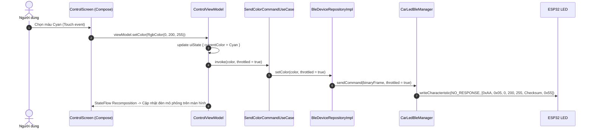

# Tài liệu Kiến trúc MVVM (Model - View - ViewModel) - Car LED Mobile App

Ứng dụng **Car LED Mobile** được xây dựng theo kiến trúc chuẩn công nghiệp hiện đại của Google: **MVVM kết hợp Clean Architecture** (3 tầng phân tách độc lập), sử dụng **Jetpack Compose**, **Kotlin Coroutines** và **StateFlow**.

---

## 1. Sơ đồ Tổng quan Kiến trúc

```
+-----------------------------------------------------------------------------------+
|                            PRESENTATION LAYER (UI)                                |
|                                                                                   |
|  +-----------------------+              (Observe StateFlow)                       |
|  |   View / Screen       |<===================================================+   |
|  | (Jetpack Compose)     |                                                    |   |
|  +-----------+-----------+                                                    |   |
|              | (User Actions / Events)                                        |   |
|              v                                                                |   |
|  +-----------------------+                                                    |   |
|  |       ViewModel       |----------------------------------------------------+   |
|  |  (StateFlow<UiState>) |                                                        |
|  +-----------+-----------+                                                        |
+--------------|--------------------------------------------------------------------+
               | (Calls UseCases)
+--------------v--------------------------------------------------------------------+
|                              DOMAIN LAYER (Pure Kotlin)                           |
|                                                                                   |
|  +-----------------------+           +-----------------------+                    |
|  |       UseCases        |---------->| Repository Interfaces |                    |
|  | (Business Logic rules)|           |  (Contracts/Ports)    |                    |
|  +-----------------------+           +-----------+-----------+                    |
|                                                  ^                                |
|                                      (Implements)|                                |
+--------------------------------------------------|--------------------------------+
                                                   |
+--------------------------------------------------|--------------------------------+
|                                DATA LAYER        |                                |
|                                                  |                                |
|  +-----------------------------------------------+                            |   |
|  |           Repository Implementations                                       |   |
|  +-----------------------+-------------------------------+--------------------+   |
|                          |                               |                        |
|                          v                               v                        |
|             +-----------------------+       +-----------------------+             |
|             |   BLE / Hardware OS   |       |   Remote API Client   |             |
|             |  (CarLedBleManager,   |       |  (Retrofit/Ktor /     |             |
|             |   GATT 133, MTU 256)  |       |   MockApiService)     |             |
|             +-----------------------+       +-----------------------+             |
+-----------------------------------------------------------------------------------+
```

---

## 2. Chi tiết 3 Tầng Kiến trúc

### 2.1. Presentation Layer (`presentation/`)
- **View (`*Screen.kt`)**: Sử dụng Jetpack Compose hoàn toàn bằng hàm khai báo (Declarative UI). View hoàn toàn **thụ động (Passive View)**: chỉ lắng nghe dữ liệu từ `UiState` và phát ra các sự kiện người dùng (onClick, onValueChange).
- **ViewModel (`*ViewModel.kt`)**: Kế thừa `androidx.lifecycle.ViewModel`, nắm giữ và điều khiển trạng thái giao diện qua `MutableStateFlow<UiState>`. ViewModel tồn tại qua các chu kỳ sống của Activity (Configuration Changes như xoay màn hình).
- **UI State (`*UiState.kt`)**: Data class bất biến (Immutable), mô hình hóa toàn diện trạng thái màn hình: dữ liệu tải về, trạng thái loading, lỗi hiển thị.

### 2.2. Domain Layer (`domain/`)
- Tầng nghiệp vụ thuần túy Kotlin, **không phụ thuộc vào Android Framework** (giúp unit test nhanh chóng và độc lập).
- **Model**: Định nghĩa các thực thể cốt lõi (`BleDeviceModel`, `LedControlState`, `User`, `Product`).
- **Repository Interface**: Định nghĩa hợp đồng dữ liệu (`BleDeviceRepository`, `AuthRepository`).
- **Use Cases**: Đóng gói các quy tắc nghiệp vụ đơn lẻ (`ScanDevicesUseCase`, `SendColorCommandUseCase`, `LoginUseCase`).

### 2.3. Data Layer (`data/`)
- Tầng triển khai thực tế của các Repository:
  - **`data/ble/`**: Điều khiển phần cứng Bluetooth qua `CarLedBleManager`, giải quyết triệt để các lỗi kinh điển trên Android:
    1. **Status 133 (`GATT_ERROR`)**: Luôn `stopScan()` trước khi `connectGatt()`, đồng thời gọi tuần tự `disconnect()` và `close()`.
    2. **Scan Throttling**: Tự động ngắt quét sau 10 giây, sử dụng `ScanFilter` với UUID service chuẩn.
    3. **Slider Lag / GATT Overload**: Throttling 40ms (~25 FPS) cho các thao tác vuốt màu hoặc độ sáng thời gian thực.
    4. **Đàm phán MTU 256**: Mở rộng kích thước gói dữ liệu sau khi kết nối thành công.
  - **`data/remote/`**: Xử lý giao tiếp REST API (Đăng nhập, danh sách sản phẩm E-commerce Flow 1).
  - **`data/local/`**: Lưu trữ SharedPreferences cho token và địa chỉ MAC thiết bị gần nhất.

---

## 3. Luồng Dữ liệu 1 Chiều (Unidirectional Data Flow - UDF)



---

## 4. Hướng dẫn Mở rộng Tính năng Mới chuẩn MVVM

Khi cần bổ sung tính năng mới (Ví dụ: Thêm tính năng **Tạo đơn hàng - Checkout**):

1. **Domain Layer**:
   - Tạo model: `domain/model/Order.kt`
   - Bổ sung phương thức vào interface: `domain/repository/OrderRepository.kt`
   - Tạo use case: `domain/usecase/order/CreateOrderUseCase.kt`

2. **Data Layer**:
   - Thêm API DTO: `data/remote/dto/OrderDto.kt`
   - Khai báo endpoint trong: `data/remote/ApiService.kt`
   - Viết implementation: `data/repository/OrderRepositoryImpl.kt`

3. **Presentation Layer**:
   - Tạo UI State: `presentation/screens/checkout/CheckoutUiState.kt`
   - Tạo ViewModel: `presentation/screens/checkout/CheckoutViewModel.kt`
   - Tạo Screen: `presentation/screens/checkout/CheckoutScreen.kt`
   - Khai báo route trong `NavRoute.kt` và thêm route vào `AppNavigation.kt`.
